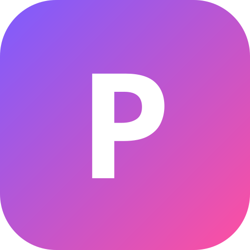

# PatOS

A macOS-style desktop operating system that runs in any web browser. It's built to work on a school Chromebook, and on an iPhone it turns into a phone OS.



## What's inside

**First start**
- A Setup Assistant asks for your language, name, look and wallpaper

**The desktop**
- Boot screen, lock screen with an optional password, Sleep, Restart and Shut Down
- Menu bar with app menus, battery (real Chromebook battery level), Wi-Fi, clock
- A dock with magnification, bouncing app icons, running-app dots, Trash, right-click menus and auto-hide
- Windows you can drag, resize, minimize (with a genie effect into the dock), zoom and snap to the left or right half
- Launchpad, Spotlight search (apps, files, notes, math, unit conversions like "5 km to mi", quick timers like "timer 10", with a preview panel), Mission Control
- Quick Look: select a file and press Space
- Control Center (brightness, volume, dark mode, Focus, full screen) and Notification Center with widgets
- Desktop widgets (clock, calendar, events, music), a particle boot intro, and windows that zoom out of the icon you clicked
- Desktop icons, drag-select, right-click menus, drag files onto folders or the Trash
- Live **three.js 3D wallpapers** (Nebula, Dot Waves, Crystals, Warp) that react to your mouse, plus 8 picture wallpapers or your own photo

**Liquid Glass**
- See-through glass on the dock, menus, Control Center, notifications, widgets and the iPhone home screen, with a light that follows your pointer
- In Chrome the glass also bends what's behind it (System Settings › Appearance)

**English and French**
- PatOS uses French when your device is in French, English otherwise; change it in System Settings › General › Language
- Pat in Messages understands its commands in French too ("ouvre calculatrice", "raconte une blague")

**On iPhone (and other phones)**
- PatOS switches to a phone layout automatically (or pick it in System Settings › General › Device style)
- Lock screen: swipe up to open
- Home screen pages with widgets and a 4-app dock; touch and hold an icon for quick actions
- Apps open full screen, zooming out of their icon
- Swipe up from the bottom bar to go home; swipe up and pause for the app switcher (swipe a card up to close it)
- Pull down from the top right for Control Center, top left for notifications; pull down on the home screen to search
- Dynamic Island shows the song that's playing
- In Safari: Share → Add to Home Screen to run PatOS full screen like a real app

**Apps**
| | |
|---|---|
| Finder | icon and list views, sorting, path bar, multi-select, color tags, info panel, Quick Look (Space), keyboard navigation, Trash, import from your computer |
| Patoogle | tabbed web browser with bookmarks, site icons and history. Sites that allow it open inside PatOS; the others open in their own window. A search opens in your device's real browser (Google or Bing) and Patoogle closes. YouTube links open in the YouTube app |
| Calendar | month and week views, event editor (time, color, notes), upcoming events, reminders |
| Notes | folders, pinned notes, #tags, checklists, drawings, pictures, tables, Recently Deleted, export to text or Docs |
| Reminders | lists with colors, due dates and times with alerts, priorities, flags, smart lists (Today, Scheduled, Flagged, All, Completed) |
| TextEdit | plain text and code editor; untitled text is kept as a draft if PatOS closes |
| Calculator (basic and scientific), Clock (world clock, alarms, stopwatch, timer), Weather (live forecast, saved cities, 24-hour chart, air quality) | |
| Music | your own songs with playlists, a queue and album art, songs composed live by your computer, a visualizer, and your device's media controls (Chromebook media keys, iPhone lock screen) |
| Photos | albums, favorites, slideshow, and an editor with filters, brightness, contrast, color, warmth, vignette, crop and rotate |
| Paint, Photo Booth | |
| Terminal | pipes (`|`), `&&`, `>` redirects; `ls -l`, `grep`, `wc`, `head`, `tail`, `sort`, `find`, `curl`, `ping`, `weather`, `todo`, `neofetch`, `matrix` and more |
| Galaxy | 3D galaxy generator (three.js) |
| Orb Runner | original 3D neon runner game (three.js) |
| 3D Studio | build a 3D scene with shapes and materials (three.js) |
| Messages | type commands to Pat: open apps, do math, add reminders and notes, tell a joke. Pat is a command helper with a fixed list of commands, not an AI |
| Passwords | encrypted password list (a device key, or your master password), strength check, generator, leak check, CSV import/export. Copy a login into a site; PatOS never saves or fills passwords on its own |
| App Store | browse every app, open it, add it to the Dock, hide or show it |
| Code Studio | HTML/CSS/JS editor with live preview and a console |
| Piano, Flashcards, Typing Trainer, Voice Memos, Stickies, Dictionary | |
| Contacts | address book with photos, favorites, birthdays and vCard import/export |
| Freeform | endless whiteboard: drawing, sticky notes, text, shapes, pictures, several boards |
| Preview | reads PDFs and pictures; highlight, draw, add text and export the annotated PDF |
| Scanner | take a photo of a page, straighten it, clean it up and save it as a PDF |
| Games | 2048, Snake, Minesweeper, Breakout, Connect Four and Memory, all offline |
| Chess | full rules against the computer (3 levels) or a friend |
| Screenshot | real screen pictures and screen recordings (on computers) |
| Tic-Tac-Toe, Maps, System Settings, Activity Monitor | |
| Docs | word processor: styles, fonts, colors, lists, tables, images, find & replace, print, export |
| Sheets | spreadsheet with real formulas (SUM, AVERAGE, IF, COUNTIF, SUMIF…), sorting, charts, CSV import/export |
| Slides | slide decks with themes, text, images, shapes, speaker notes and full-screen presenting with transitions |
| Drive | every document, spreadsheet, presentation and form in one place |
| Forms | surveys and graded quizzes with a results view |
| Translate | 20 languages (MyMemory, needs internet) with read-aloud |
| Grapher | graphing calculator: functions, points, inequalities, polar curves, sliders, roots, highs and lows, crossing points, tables of values, save as a picture |
| Elements | the full periodic table with details on all 118 elements, category filters and a molar mass calculator |
| Focus | study timer (25/5/15) with your task, rain or noise sounds, a daily goal, streaks and a 7-day chart |
| Journal | one page a day with your mood, a writing prompt, word count, streak and search |
| Sudoku | fresh puzzles with one solution (easy, medium, hard), notes, hints, undo, timer and best times |
| YouTube | works like youtube.com: home feed, search with suggestions, Shorts, channels, comments, related videos, autoplay, subscriptions, likes, Watch later and history. No API key needed on the PatOS website |
| News | live headlines from NPR, Al Jazeera, Engadget, Space.com, NASA, Radio-Canada and La Presse, with saved stories |
| Books | 70,000 free classics from Project Gutenberg in a page-turning reader (text size, themes, remembers your page) |
| Radio | thousands of live radio stations from around the world, by country or genre, with favorites |
| Videos | play your own video files with speed control and Picture in Picture |
| Phone & Web apps | install Snapchat, Instagram, TikTok, WhatsApp, Spotify, Discord, Roblox and 30 more from the App Store. On iPhone/iPad they open the real app (or its App Store page), on Android/Samsung the real app (or Google Play), and on a computer the app's website (inside PatOS when the site allows it, otherwise in its own window) |
| Solitaire | classic Klondike: drag or tap, draw 1 or 3, undo, auto-finish, stats |

## Keyboard shortcuts

Chromebooks reserve most Ctrl shortcuts, so PatOS uses **Alt**:

| Keys | Action |
|---|---|
| Ctrl+Space or Alt+Space | Spotlight |
| Alt+L or F4 | Launchpad |
| Hold Alt, press ` | App switcher |
| Alt+↑ or F3 | Mission Control |
| Alt+W / Alt+Q / Alt+M | Close window / Quit app / Minimize |
| Alt+← / Alt+→ | Tile window left / right |
| Alt+T / Alt+E / Alt+B / Alt+, | Terminal / Finder / Patoogle / Settings |

## Running it

**On a Chromebook with no setup:** download `dist/PatOS.html` and open it. Everything (including three.js) is inside that one file and works offline.

**Locally:** open `index.html`, or run `npm start` and go to http://localhost:3000.

**On Render (Web Service):**
- Build Command: `yarn install; yarn build` (or `npm install && npm run build`)
- Start Command: `yarn start` (or `npm start`)
- Environment variables: none needed. Render sets `PORT` itself.

YouTube, News and Books get their data through the PatOS server (`yt.js`, `services.js`), so they work on the website. The single-file and Claude Artifact versions have no server, so those apps ask you to open the website.

Once it's on a real website, Chrome can install it as an app (⋮ menu → Install), and it keeps working offline.

**Rebuild the single-file versions** after changing code: `npm run build` (writes `dist/PatOS.html` and `dist/artifact.html`).

## How it's built

Plain HTML, CSS and JavaScript with no npm dependencies. `build.js` only makes the single-file versions and the offline service worker. three.js r160, pdf.js and pdf-lib are in `vendor/` so they load even when school Wi-Fi blocks CDNs. three.js is only loaded when something 3D is about to show (a live wallpaper or a 3D app), and every 3D animation waits for the graphics chip to finish a frame before drawing the next, so slower Chromebooks get fewer frames instead of lag. Your files, notes and settings are saved in the browser's database (IndexedDB), which can hold gigabytes; System Settings › Storage can back them up to a file.

## Security

- Documents, notes, slides and pasted text are cleaned before they are shown, so a file can't run scripts inside PatOS.
- Passwords are encrypted whenever the browser allows it. Without a master password the key belongs to this browser on this device (anyone using it can open them, so a master password is recommended). With one, the list stays locked until you type it, and locks again when PatOS locks, when you close Passwords, or after 15 minutes without using the vault (working in another app doesn't count). Only a very old browser, or one that can't keep the device key, falls back to plain text, and Passwords shows a red warning when that happens.
- Programs you run in Terminal (JavaScript) and Python live in a Worker that is locked down before your code starts: it can't open PatOS's database, caches, file-system storage or service worker, or start more workers, so a program can't read your files or the password list's key. It can still compute and use the internet like any web page. This is a barrier, not a virtual machine, so the master password remains the real protection for passwords, and you should still only run code you trust. Terminal's `node` runs JavaScript in the browser; it isn't Node.js (no `require` or npm).
- The PatOS server only checks public websites for Patoogle (no private or local network addresses, re-checked after every redirect), and never serves its own source, tests or `node_modules`.

## Backups

Settings › Backup & Restore. PatOS keeps a snapshot of your files and settings every day (the last 7) and one before any restore. **Export** saves everything to one `.patos-backup` file (optionally locked with a password; on an iPhone it goes to Files). On Chrome (computer or Chromebook) an **auto-backup folder** gets a backup file every day; it is on the real disk, so it survives even if PatOS or the website is deleted. A new copy of PatOS offers *I already have a backup* on its first screen. Big files (videos) are not in snapshots; a backup file includes them up to 150 MB. Passwords protected only by the device key can't be opened on another device, so add a master password.

## Sync

Settings › Sync (optional). Turn it on, get a 28-character code, and type it in Settings › Sync on another device (a Chromebook and an iPhone, say). Files, notes, calendar, reminders, contacts, flashcards and some settings then follow you. PatOS never waits for it: everything is saved on the device first, it works offline, and changes go out when the internet is back (and every few minutes, when you change something, and when you come back to the window).

- **Encrypted on the device.** Each item is sealed with AES-GCM before it leaves; the key (and the account id and login token) come from the code with HKDF. The server (`sync-server.js`) stores only a hash of the token, scrambled ids and scrambled bytes, a time and a size. It cannot read file names or contents. The code is your only key: nobody can reset it. It is saved in backups, so keep backup files locked with a password.
- **Which version wins.** The later change wins, per item (a file, one saved list such as Notes, the settings), judged by the devices' clocks. A deletion is a change. A device that joins keeps what only it has; for things on both sides the server's version is used, after a safety snapshot. If most of your items vanish at once, Sync asks before deleting them elsewhere. Notes and other saved lists are one item each, so two devices editing the *same* list offline at once keep the later device's whole list.
- **Big files** (videos, recordings, anything over about 9 MB) stay on the device where they are.
- **A new Railway.** Accounts live in `PATOS_DATA/sync` (mount a volume there). If that folder is ever lost, the next device that syncs creates the account again and sends everything. A brand new site works the same way: restore a backup (it carries the code) or join with the code. Limits: `SYNC_QUOTA_MB` (300 per account), `SYNC_MAX_ACCOUNTS` (200), `SYNC_RATE` (240 requests a minute per address).

## Updates

`updates.json` lists every version, newest first, with what changed (English and French). `npm run build` turns it into `js/version.js`. While PatOS is open it checks the server every few minutes: you get "Update available", then "Ready to install", which opens Settings › Software Update with the version and its notes. Restart PatOS installs it on PatOS's own boot screen and brings your windows back. To publish an update: add an entry at the top of `updates.json`, run `npm run build`, push, and let Railway deploy. A release being built has a `"beta": N` number: raise N with each push and add its notes; only people with Settings › Software Update › Beta updates on are told about it (the switch chooses what you are told, not what is downloaded: PatOS has one website, so everyone's copy gets the newest files, and a beta can start running at the next restart even with the switch off. Truly separate channels would need a second Railway deployment) (everyone gets the files, since there is one website). When it is ready, delete `"beta"` and push: everyone gets the normal update.

## Tests

`npm test` runs everything (`npm ci` installs the exact Playwright version from `package-lock.json`; `npx playwright install chromium` fetches its browser): server tests, then browser tests in Chromium through Playwright (file system, saving, every app in English, French and on an iPhone, file formats, offline start, crash recovery, timers, Spotlight, security). Browser tests are skipped when Playwright isn't installed. See `test/README.md`.

```
index.html          the page
css/                shell + app styles
js/core.js          storage, file system, settings, sounds, app registry
js/wm.js            window manager
js/shell.js         menu bar, dock, Launchpad, Spotlight, Control Center…
js/wallpaper.js     picture + live 3D wallpapers
js/apps/*.js        one file per app
server.js           tiny server for Render (static files + /api)
yt.js               YouTube data for the YouTube app (no API key)
services.js         News and Books data
build.js            makes the single-file versions in dist/
```

## Storage, files and code (added)
- Everything is stored in IndexedDB (large quota, survives reloads). Old localStorage data migrates once.
- Real files: open files from the Chromebook or link a folder (File System Access API), save copies back.
- Real formats: Docs/Sheets/Slides import and export .docx/.xlsx/.pptx; zip compress/extract.
- Screen Recorder: screen with optional microphone, system sound and camera bubble; saves to Videos.
- Python (Pyodide, served by `/pyodide/*`) in Code Studio and Terminal (`python`, `node`).
- `/api/frameable` tells Patoogle whether a site allows being shown inside PatOS; if not, it opens in its own window.

## Using PatOS as your main system (added)
- **Install as an app**: Settings › Install & Start Up. Opens in its own window; the Chromebook's Files app can "Open with › PatOS"; shelf shortcuts.
- **Offline**: Docs, Sheets, Slides, Notes, Code Studio (Python too), Files, PDFs, books you opened, saved news and weather.
- **Alarms, timers, reminders** ring on time in the background, with Chrome notifications (Stop / Snooze).
- **Spotlight** (Ctrl+Space): apps, settings, files and their contents, notes, reminders, contacts, passwords, websites, quick actions.
- **Google** in the Dock: Classroom, Docs, Drive and more open in the real browser.
- **Preview** reads and annotates PDFs (highlight, pen, text, export). **Scanner** turns photos of pages into a PDF.
- **Notes** with real checklists, drawings and #tags. **Grapher** is a full graphing calculator. **Games** (2048, Snake, Minesweeper, Breakout, Connect Four, Memory). **Music** with playlists, a queue and album art.
- **Windows come back** after a reload or a crash; **updates are safe**: if a new version doesn't start, PatOS goes back to the previous one.
- **Phones**: on a real iPhone or Android phone PatOS uses the phone's own status bar and safe areas, has an app bar with Home/Back, list → detail screens, and works with the back button.

Third-party files: `vendor/pdf/` holds pdf.js 3.11.174 (Apache-2.0) and pdf-lib 1.17.1 (MIT), with their licenses.
